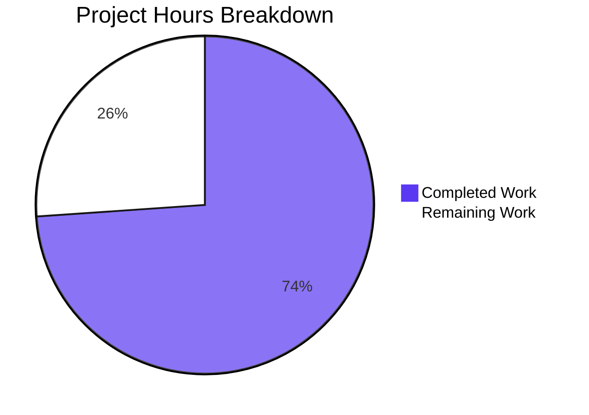

# 1. Executive Summary

Release-readiness assessment of a two-endpoint Node.js teaching server: what is delivered and verified, what remains, and every recorded divergence.

## 1.1 Project Overview

`nodejs-tutorial-hello-world` is a dependency-free Node.js HTTP server used as a teaching reference. This change adds a second plain-text route — `GET /good-evening` answers `200` with the body `Good evening`, written through the same shared writer as `GET /hello` — and the automated suite that proves both endpoints, the refusal contract and the process lifecycle over real HTTP. It is written for developers learning Node.js and for instructors. The deliverable stays one module, one manifest, one test file and the README, with nothing installed.

## 1.2 Completion Status

**34 hours completed of 46 total hours — 12 hours remaining — 74% complete.**

Pie colours: Completed = Dark Blue `#5B39F3`; Remaining = White `#FFFFFF`.



| Metric | Hours |
|---|---|
| Total Hours | 46 |
| Completed Hours (AI + Manual) | 34 |
| Remaining Hours | 12 |
| Completion | 74% (34 / 46) |

Every requirement the change was set is delivered and verified. The 12 remaining hours are path-to-release work, itemised in Section 2.2.

## 1.3 Key Accomplishments

- **`GET /good-evening`** — 200, `text/plain`, 12-byte `Good evening`, fixed-length framing (`server.js:56`, `server.js:74-76`).
- **`GET /hello` unchanged** — 200, 11-byte `Hello world` from the same process (`server.js:55`, `server.js:70-72`).
- **Uniform refusal contract** — 404 with the 9-byte `Not Found`, no `405`, no `Allow` (`server.js:59-68`).
- **Inherited matching intact** — query string ignored, trailing slash and guard-rejected targets refused (`server.js:25-48`).
- **Automated suite** — five cases over one spawned server, stop and port release asserted (`test/good-evening.test.js`).
- **Nothing installed** — six built-in modules, no dependency key, no lockfile (`package.json:1-20`).
- **Documentation in step** — contract table, transcripts, byte counts, HTTP/1.0 framing, the suite's Node floor (`README.md:5-159`).
- **Lifecycle unchanged** — startup line, one log line per request, `SIGINT` exit 0 with both shutdown lines (`server.js:153-179`).

## 1.4 Critical Unresolved Issues

**6 of the 32 items this work was scoped against remain open.** All 26 requirements are delivered and verified; the six below are path-to-release follow-ups.

| Issue | Impact | Owner | ETA |
|---|---|---|---|
| `engines.node` declares `>=18.0.0` while the suite's `before`/`after` hooks exist only from Node 18.8.0, so `npm test` fails on a missing export between 18.0.0 and 18.7.x | Blocks the suite, not the server, on the older patch levels the manifest admits | Configuration owner | 1 day |
| No execution recorded on the oldest runtime the suite supports, nor on a current LTS release | Release risk confined to the declared runtime floor | QA | 1 day |
| The `PORT`-unset default (3000) and the `EADDRINUSE` advice path have never been exercised at runtime | Low residual risk in two configuration paths | QA | 0.5 day |
| `HEAD` on a registered path, the `CONNECT` refusal, guard-rejected targets and the new endpoint's own log line are exercised by ad-hoc probes, not by the automated suite | A regression there would not fail `npm test` | Developer | 1 day |
| `blitzy/documentation/Project Guide - 2c839122-5eed-4b26-8acb-19a7ba45cb75.md` still describes a single-endpoint, three-file deliverable | A reader inside the repository meets text that contradicts the shipped behaviour | Documentation owner | 0.5 day |
| `SIGKILL` delivered to the test-file process itself can leave its spawned server holding its port | CI hygiene only; every trappable exit is already reaped | Developer | 0.5 day |

## 1.5 Access Issues

No access issues identified: the work needs no credential, service, store or permission, only a local Node.js runtime.

## 1.6 Recommended Next Steps

1. [High] Raise `engines.node` to the suite's minimum, then re-run `npm test`.
2. [High] Run the suite on the oldest supported runtime and on a current LTS release.
3. [Medium] Add cases for `HEAD`, `CONNECT`, guard-rejected targets and the log line.
4. [Medium] Exercise the default-port and `EADDRINUSE` paths where port 3000 is free.
5. [Low] Refresh the stale generated status report; close the untrappable-signal gap.

# 2. Project Hours Breakdown

Hours are measured against the scope of this change: the requirements it was set, and the activities needed to carry the delivered files to release. **34 completed + 12 remaining = 46 total hours; 34 / 46 = 74% complete.**

## 2.1 Completed Work Detail

| Component | Hours | Description |
|---|---|---|
| Route registration and dispatch | 2 | `GET /good-evening` added to the compound-key route table beside `GET /hello`, resolved by the existing `${req.method} ${pathname}` lookup with no new matching logic (`server.js:54-60`). |
| Endpoint handler and shared writer | 3 | Named sibling handler `handleGoodEvening` writing through `sendText` with status 200 and the constant body; no status or header set in the handler, so the runtime derives `Content-Length` and the response stays fixed-length (`server.js:74-76`, `server.js:84-94`). |
| Verification artefact | 14 | `test/good-evening.test.js`: five cases over one spawned server plus the harness — free-port discovery with range assertion and bounded retry on a lost port, readiness on the buffered startup line, per-request sockets, a bounded request, a `SIGINT` stop settled once every buffered chunk has arrived, a bounded escalation, a port-release assertion by re-binding, and child reaping from `SIGINT`, `SIGTERM`, `exit` and absorbed pipe errors. |
| Manifest entry and description | 1 | `test` script added beside an untouched `start` script, and a `description` naming both endpoints; no dependency key, no lockfile (`package.json:4`, `package.json:6-9`). |
| Documentation statements | 3 | README summary sentence, contract-table row, `curl` block and transcript, checklist clause, fixed-body byte counts with the HTTP/1.0 framing statement, and the test-suite sentence carrying the suite's Node floor (`README.md:5-14`, `README.md:65`, `README.md:74`, `README.md:113`, `README.md:134-159`). |
| Annotation accuracy | 2 | Every shipped comment in `server.js` and the suite states the constraint or invariant its code keeps: the request-target form guard, the shared-writer framing rule and its caller count, readiness matching, the `close`-versus-`exit` distinction, retry classification, and the reaper's reason for existing (`server.js:37-39`, `server.js:85-90`). |
| End-to-end verification | 9 | Contract smokes over real sockets against the running process — both endpoints, six refusal paths, `HEAD`, raw HTTP/1.0 framing, the request-log line, the port-gate refusal, `SIGINT` exit status and immediate port release — plus suite stability across repeated runs and a real browser client. |
| **Total** | **34** | |

## 2.2 Remaining Work Detail

| Category | Hours | Priority |
|---|---|---|
| Runtime floor alignment — raise the declared runtime minimum to the suite's real minimum so `npm test` cannot be run where its hooks are missing | 1 | High |
| Supported-runtime verification — run the suite and the README procedure on the oldest supported runtime and on a current LTS release | 2 | High |
| Configuration paths never exercised — the `PORT`-unset default and the `EADDRINUSE` advice path | 1 | Medium |
| Automated coverage of inherited behaviour — `HEAD` on a registered path, the `CONNECT` refusal, guard-rejected targets and the new endpoint's log line | 4 | Medium |
| Repository artefact hygiene — refresh or retire the stale generated status report | 2 | Low |
| Harness hardening — child cleanup when `SIGKILL` is delivered to the test-file process | 2 | Low |
| **Total** | **12** | |

Each hour above traces to a path-to-release need rather than to an unmet requirement: all 26 requirements are delivered and verified, and the remaining work hardens the runtime declaration, the coverage of inherited behaviour and the repository's own artefacts.

# 3. Test Results

The suite is the project's one automated artefact and runs on Node's built-in runner with no framework installed. The totals below come from the suite's own counters (`# tests 5 / # pass 5 / # fail 0`, exit status 0) and from the live HTTP batteries driven against the running process. No coverage percentage is reported: the dependency-free constraint the project imposes rules out a coverage tool.

| Area / Category | Framework | Tests | Passed | Failed | Coverage | What This Proves |
|---|---|---|---|---|---|---|
| Added endpoint contract | `node:test` (`node --test test/good-evening.test.js`) | 1 case / 6 assertions | 1 | 0 | Not measured | `GET /good-evening` answers 200 `text/plain` with the byte-exact 12-byte body `Good evening` and fixed-length framing. |
| Preserved endpoint | `node:test` | 1 case / 6 assertions | 1 | 0 | Not measured | `GET /hello` still answers 200 with the 11-byte body `Hello world` from the same running process. |
| Refusal contract | `node:test` | 1 case / 5 assertions over 2 method-and-target pairs | 1 | 0 | Not measured | An unregistered method or path answers 404 with the 9-byte `Not Found` and no `Allow` header. |
| Matching edges | `node:test` | 1 case / 4 assertions | 1 | 0 | Not measured | A query string does not change the match, and a trailing slash is a different path. |
| Start, stop and port release | `node:test` `before`/`after` hooks | 2 hooks / 6 assertions | 2 | 0 | Not measured | The server reaches readiness on its own startup line, stops through `SIGINT` with exit status 0 and empty stderr, and frees its port. |
| Whole contract over real HTTP | `curl` and raw sockets (Node probes) | 43 checks | 43 | 0 | Not measured | Both endpoints, six refusal paths, `HEAD`, raw HTTP/1.0 framing, the request-log line, the port-gate refusal and the shutdown/release sequence all hold on the running process. |
| Real browser client | Headless Chrome | 4 navigations | 4 | 0 | Not measured | A real HTTP/1.1 client sees the documented status, `Content-Type`, `Content-Length` and rendered body on both endpoints and an ordinary 404 document, with no JavaScript error and no failed request. |
| Syntax gate | `node --check` | 2 files | 2 | 0 | Not measured | Both JavaScript modules parse cleanly; the project has no build step and writes no build output. |

**Not Covered**

- The `PORT`-unset default-3000 path and the `EADDRINUSE` advice line: no test and no manual run exercises either, because the change does not touch `resolvePort` and no machine used for this verification could bind 3000. Before release, start the server with `PORT` unset where 3000 is free, and separately hold 3000 with another listener to see the advice line.
- The suite on Node 18.0.0–18.7.x: the declared floor admits those patch levels but the suite's `before`/`after` hooks do not exist there. Run `npm test` once on the oldest supported runtime and once on a current LTS release before release.
- `HEAD` on a registered path, the `CONNECT` refusal, a guard-rejected target such as `//hello`, and the new endpoint's own request-log line: all are exercised against the running process but by ad-hoc probes rather than by a case in the suite, so nothing would fail `npm test` if one regressed. Add one case per behaviour before relying on the suite as the release gate.
- No coverage percentage exists for any area above, so coverage is evidenced by the behaviour list rather than by a metric.

# 4. Runtime Validation & UI Verification

Everything below was driven against the server as a running process over real HTTP — the suite spawns it on a discovered free port, and the live batteries speak to it with `curl`, raw sockets and a real browser. The project serves plain-text bodies only, so there is no graphical interface to verify.

1. ✅ Startup, readiness and the port gate — `Server listening on port <port>` printed after the bind with empty stderr; `PORT=99` refused on stderr with exit status 1 and nothing on stdout before any socket exists.
2. ✅ `GET /hello` — 200, `Content-Type: text/plain`, `Content-Length: 11`, body `Hello world`.
3. ✅ `GET /good-evening` — 200, `text/plain`, `Content-Length: 12`, body `Good evening`; a query string does not change either the match or the body.
4. ✅ Refusal paths — `/hello/`, `/good-evening/`, `/unknown`, `/`, `POST /hello` and `POST /good-evening` all answer 404 with the 9-byte `Not Found`, no `Allow` header and no 405.
5. ✅ `HEAD` on a registered path — the 404 status line with headers, no body and no `Content-Length`.
6. ✅ `CONNECT` — the fixed 404 bytes written to the tunnelled socket, which is then released; a vanished peer is absorbed rather than crashing the process.
7. ✅ Framing — no `Transfer-Encoding` on any response: HTTP/1.1 carries `Content-Length` 11/12/9, while a raw HTTP/1.0 request receives `Connection: close` with neither `Content-Length` nor `Keep-Alive` and its body delimited by the close.
8. ✅ Request logging — one three-field line per dispatched request, written before routing, with the query string excluded and no stack trace.
9. ✅ Shutdown and release — `SIGINT` prints `Received SIGINT, shutting down` and `Server closed`, exits with status 0 and empty stderr, and the port is immediately re-bindable by a fresh listener.
10. ⚠ Never exercised at runtime — the `PORT`-unset default-3000 path, the `EADDRINUSE` advice line, the suite on Node 18.0.0–18.7.x, and child cleanup when `SIGKILL` is delivered to the test-file process (untrappable by design). A browser client was used for both endpoints and for a refused path: the plain-text bodies render as raw text, with zero JavaScript errors and zero failed requests.

# 5. Compliance & Quality Review

Compliance is judged against the Blitzy quality benchmarks and the binding decisions the change was set, and each row states where the deliverable stands in the revision being handed over.

## 5.1 Compliance Matrix

| # | Deliverable | Benchmark | Status |
|---|---|---|---|
| 1 | `GET /good-evening` route and handler | Functional completeness; endpoint contract fidelity | ✅ Pass |
| 2 | Preserved `GET /hello` contract | No-regression / preservation set | ✅ Pass |
| 3 | Startup with both endpoints registered | Operability; startup error freedom | ✅ Pass |
| 4 | Automated suite on the built-in runner | Test automation without new dependencies | ✅ Pass |
| 5 | Manifest: script added, identity preserved | Configuration discipline; no dependency, no lockfile | ✅ Pass |
| 6 | Documentation truth across README and manifest | Accuracy of shipped statements | ✅ Pass |
| 7 | Minimal change and preservation of untouched behaviour | Change discipline; reviewability | ✅ Pass |
| 8 | Refusal contract and inherited edge behaviour | Correctness of error and edge handling | ✅ Pass |
| 9 | Code style, comments and API shape | Readability; convention adherence | ✅ Pass |
| 10 | Verification evidence for the added and preserved behaviour | Evidence sufficiency | ✅ Pass |
| 11 | Security posture — constant bodies, no credential, no input echoed into a response | Enterprise baseline for a network-facing process | ✅ Pass |
| 12 | Declared runtime floor against the suite's real minimum | Release readiness | ⚠ Caveat — documented at `README.md:65`, not reconciled in the manifest (Section 5.2, row 7) |

## 5.2 AAP & Rule Divergences and Gaps

Seven divergences were established between what the plan required and what the repository now carries. Each is a deliberate, recorded departure rather than a defect; four are settled by a higher source, two are wording-level, and one is an accepted caveat with a release action attached.

| # | What the AAP/Rule Required | What Was Delivered Instead | Why It Diverged | Impact | Remediation |
|---|---|---|---|---|---|
| 1 | Editing `server.js` limited to two insertions and the one writer comment clause; "nothing outside those three edits differs" | A fourth, comment-only edit: the request-target form-guard comment reworded at `server.js:37-39` (2 comment lines out, 2 in; zero non-comment lines changed) | The second route makes the guard's behaviour matter, so the annotation must state what the guard rejects and what the parse would yield without it; the change's own documentation-truth rule requires shipped text to read true | Comment text only; no behaviour, symbol, signature, test expectation or other comment line moves | None. Revert those two lines only if the literal edit list is to govern |
| 2 | The fixed-bodies/framing sentence listed among clauses that "stay true and unchanged" | That sentence now scopes fixed-length framing to HTTP/1.1 and states the HTTP/1.0 case at `README.md:159`; the server's framing is untouched | The universal claim does not hold for an HTTP/1.0 client, which is observable live, and the clause's own qualifier is "stays true" | Documentation only; no behaviour, symbol, interface or test moved | None. Tighten the sentence only if a strictly literal reading is preferred |
| 3 | "Stop with `SIGINT` and await the `exit` event" | The stop settles on the child's `close` event (`test/good-evening.test.js:213-222`), which follows `exit`, carries the same code and signal, and fires only once the child's buffered output has been handed over | `exit` does not guarantee the piped stdout and stderr have been delivered, yet the same requirement asserts on the two shutdown lines and on an empty stderr | None: same signal sent, same assertions, same outcome, settled in the safe direction | None |
| 4 | A per-change lint and static-analysis pass | Read-only equivalents: `node --check` on both modules, a JSON parse of the manifest, `git diff --check`, style and whitespace scans, and live contract probes | No linter, formatter or markdownlint configuration exists in the repository, and adding tooling is forbidden by the change's own dependency-free constraint | None on the product; a rule-catchable formatting defect would not be caught automatically | None, unless the project later admits development tooling |
| 5 | The suite described as four helpers | Six helper functions: `discoverFreePort`, `startOnce`/`startServer`, `request`, `stopServer`, `assertPortReleased`, and the reaping pair `reapLiveChild`/`endBySignal` | The retry and the release assertion the plan describes are each a named function, and reaping is what cleans the child up on every trappable exit | Cosmetic description drift; the artefact set is unchanged and `test/` still holds one file with no fixture or helper module | None |
| 6 | Documentation truth — every statement the change falsifies is corrected wherever it ships | The generated status report `blitzy/documentation/Project Guide - 2c839122-5eed-4b26-8acb-19a7ba45cb75.md` still describes a single-endpoint, three-file deliverable and was not modified | The scope boundary exempts `blitzy/**`, which records an earlier task's state rather than the shipped contract | A reader inside the repository meets text that contradicts the server; nothing outside the repository is affected | Refresh or retire the file (Section 2.2, 2 hours) |
| 7 | The declared runtime floor stands as written in the manifest and Prerequisites | Both kept as declared, with the suite's real minimum (Node 18.8.0, for its `before`/`after` hooks) stated in the verification section at `README.md:65` | The request fixes the manifest declaration and puts configuration changes out of scope, and the README edit set was fixed too | On Node 18.0.0–18.7.x `npm test` fails on a missing hook export while the server itself runs correctly | Raise `engines.node` to `>=18.8.0` and match the Prerequisites line (Section 2.2, 1 hour) |

**Row 1 — the form-guard annotation.** The guard exists because the parse adopts the authority a target itself names, so `//host/hello` would otherwise be matched against the local route table. The annotation at `server.js:37-39` states the guard's own outcome: a rejected target takes the ordinary 404, `//hello` included, because it names no path of its own, and the parse would yield the base's `/` only without the guard. That is what the code does — `ORIGIN_FORM` and `ABSOLUTE_FORM` (`server.js:25-26`) reject `//hello`, the guard returns `null` at `server.js:40-42`, and the request answers 404 with `Content-Length: 9` and the raw target in the log line, all observed on the running process. The guard, the two regexes and the parse are byte-identical to the pre-change file; only the two comment lines differ, so nothing the minimal-change rule protects is touched.

**Row 2 — the HTTP/1.0 framing statement.** The sentence claimed that "the response is always framed as a fixed length", which is false for every HTTP/1.0 client: a raw `GET /good-evening HTTP/1.0` receives `HTTP/1.1 200 OK`, `Content-Type: text/plain`, `Date` and `Connection: close`, with neither `Content-Length` nor `Keep-Alive`, and its 12 bytes delimited by the close — the same shape on `/hello` and on a refused path. The delivered sentence keeps the fixed-length claim for HTTP/1.1 and states the HTTP/1.0 case in the following clause (`README.md:159`), so the paragraph read as a whole is accurate. The server's own framing behaviour is unchanged, and a 1.0 client's header shape is the documented behaviour rather than a defect to repair.

**Row 3 — the stop event.** The suite's stop path sends `SIGINT` — the only signal the server handles (`server.js:156`) — awaits the child's termination, asserts signal `null`, exit status 0, both shutdown lines and an empty stderr, escalates to `SIGKILL` behind a bounded wait if the child outlives it, and proves release by re-binding the port. The only departure is which of two adjacent child events the settle hangs on: `close` rather than `exit` (`test/good-evening.test.js:213-222`). Every observable the requirement names is preserved, and `close` is the event that guarantees the child's piped output has arrived, which is exactly what the hook then asserts.

**Row 4 — the lint step.** The repository declares no linter, formatter or lint script, and the change's constraint is that nothing may be installed into a dependency-free teaching reference. The verification that could run without adding tooling was run in its place and is reported in Section 3: the syntax gate on both modules, a parse of the manifest to its seven keys with zero dependency keys, `git diff --check`, scans for tabs, trailing whitespace and stray quoting, and the live HTTP contract batteries. A reviewer reading `package.json` will find no tooling to run, which is the intended state.

**Row 5 — the helper set.** The plan's sketch of the suite named four helpers; the delivered file names six, because port discovery, the retry-bearing start and the release assertion each became their own function and the child-reaping pair exists so the spawned server cannot outlive the run. Two named helpers (`startOnce`, `assertPortReleased`) realise exactly the retry and release behaviours the plan describes, and `reapLiveChild`/`endBySignal` implement cleanup on `SIGINT`, `SIGTERM` and `exit`. Nothing in the artefact contract moves: `test/` holds the one planned file, no fixture or helper module was added, and `node --test` discovers exactly five cases.

**Row 6 — the generated status report.** The scope boundary marks the `blitzy/**` subtree out of scope because it records an earlier task's state, so the rule that every falsified statement is corrected was applied to the shipped files — README, manifest and module — and not to that report. The practical consequence is a repository holding two descriptions of the product, one of which names a single-endpoint, three-file server at its line 5 and lists one route in its per-endpoint table. Nothing a consumer installs is affected. Refreshing or deleting that file is the cheapest way to remove the contradiction.

**Row 7 — the runtime floor.** The manifest declares `"engines": { "node": ">=18.0.0" }` (`package.json:10-12`) and the Prerequisites section repeats it (`README.md:19`), while the suite's `before`/`after` hooks arrived in Node 18.8.0, so a runner between 18.0.0 and 18.7.x fails `npm test` on a missing export rather than executing it. The declared floor was deliberately left as written; the real minimum is stated where the person running the suite reads it (`README.md:65`), and the server itself runs on the declared floor. Closing the gap is one hour of configuration work and one run of the suite on the raised floor, and it is the highest-priority remaining item in Section 2.2.

# 6. Risk Assessment

| Risk | Category | Severity | Probability | Mitigation | Status |
|---|---|---|---|---|---|
| The declared runtime floor admits Node 18.0.0–18.7.x, where the suite's hooks do not exist and `npm test` fails on a missing export | Technical / Operational | Medium | High | Raise `engines.node` to `>=18.8.0` and match the Prerequisites line; state the floor in the README's verification section meanwhile (`README.md:65`) | Open |
| No continuous integration: `npm test` runs only when someone runs it, so a regression can ship unnoticed | Operational | Medium | Medium | Add a single pipeline job running `node --check` on both modules and `npm test`, or adopt a documented release checklist that requires both | Open |
| No execution recorded on the oldest supported runtime or on a current LTS release | Technical / Release | Medium | Medium | Run the suite and the README procedure on Node 18.8.x and on a current LTS before release | Open |
| Inherited behaviour — `HEAD` on a registered path, the `CONNECT` refusal, guard-rejected targets and the new endpoint's log line — is proved only by ad-hoc probes, so a regression there would not fail the suite | Technical | Low | Medium | Add one case per behaviour to `test/good-evening.test.js` | Open |
| A regression in the inherited refusal or matching paths is otherwise uncovered by automated checks | Technical | Low | Low | Same as the row above; the refusal and matching cases the suite does carry are the model to extend | Open |
| A free discovered port can be taken between the probe's release and the child's bind on a heavily loaded host | Technical | Low | Medium | The bounded retry with a fresh port and the child's own in-use line already recover from it; keep the retry count and the readiness, stop and release timeouts under review | Mitigated |
| `SIGKILL` delivered to the test-file process can leave the spawned server alive holding its port | Operational | Low | Low | Every trappable exit reaps the child; closing this last gap needs a helper module or a change to `server.js`, both currently outside the change's constraints | Accepted |
| The security posture rests on the response surface being constant — no attacker-derived value reaches a body, header or status — so a future route that echoes input or derives a path would invalidate it | Security | Low | Low | Re-assess the posture before adding any route that consumes input; the current code offers no sanitisation helper to reuse | Accepted by design |

# 7. Visual Project Status

Completed work is shown in Blitzy Dark Blue `#5B39F3`; remaining work in White `#FFFFFF`.


Remaining hours by category (Section 2.2) and by priority:

| Category | Hours | Priority |
|---|---|---|
| Runtime floor alignment | 1 | High |
| Supported-runtime verification | 2 | High |
| Configuration paths never exercised | 1 | Medium |
| Automated coverage of inherited behaviour | 4 | Medium |
| Repository artefact hygiene | 2 | Low |
| Harness hardening | 2 | Low |
| **Total remaining** | **12** | |

| Priority | Hours | Share of remaining |
|---|---|---|
| High | 3 | 25% |
| Medium | 5 | 42% |
| Low | 4 | 33% |
| **Total** | **12** | **100%** |

Status at a glance: 34 of 46 scoped hours are complete (74%), every requirement is delivered and verified, and the remaining 12 hours are the six release follow-ups listed in Section 2.2 — of which the 3 High-priority hours (runtime floor alignment and supported-runtime verification) are the critical path to release.

# 8. Summary & Recommendations

The release delivers a second plain-text route to a dependency-free Node.js HTTP server, together with the automated suite and the documentation that make the route safe to rely on. `GET /good-evening` answers `200` with the byte-exact 12-byte body `Good evening`, written through the same shared response writer as `GET /hello`, so status, `Content-Type` and framing cannot diverge between routes; the existing endpoint is unchanged, and every unregistered method or path still answers `404` with the 9-byte `Not Found`, no `405` and no `Allow` header. The module's annotations, the manifest, the README contract table, the verification procedure and its transcripts all state what the process actually does. **34 of the 46 hours this work was scoped against are complete — 74%** — and every requirement the change was set is delivered and verified; the remaining 12 hours are release follow-ups rather than unfinished scope.

What the reader can rely on was exercised rather than assumed. The five-case suite starts the real server on a discovered free port and proves both endpoint contracts, the refusal contract and the matching edges over real HTTP, then asserts the process's own shutdown behaviour — exit status 0, both shutdown lines, empty stderr and a port that can be re-bound immediately. Around it, 43 live checks over `curl` and raw sockets confirm the refusal paths, `HEAD`, the request-log line, the port gate's refusal message and the HTTP/1.0 close-delimited case, and a real browser client sees the documented status, headers and bodies on both endpoints and an ordinary 404 document with no JavaScript error and no failed request. Both modules pass `node --check`; the project still declares zero dependencies, ships no lockfile and installs nothing.

Six items remain open, itemised with hours in Sections 1.4 and 2.2. The critical path is the first three hours: the manifest declares `>=18.0.0` while the suite's hooks exist only from Node 18.8.0, so the runtime floor should be raised and the suite then run once on the oldest supported runtime and once on a current LTS release. Next, four hours of automated coverage would move `HEAD` on a registered path, the `CONNECT` refusal, guard-rejected targets and the new endpoint's log line out of ad-hoc probes and into the suite, so `npm test` becomes the release gate rather than a partial one. The last two items are hygiene: a generated status report inside the repository still describes a single-endpoint deliverable, and a `SIGKILL` aimed at the test-file process can orphan its server child.

Seven divergences are recorded in Section 5.2, and each is settled rather than pending. Four follow from a higher source: the form-guard annotation, which the second route makes inaccurate and which therefore names the guard's own rejection; the framing statement, whose universal claim does not hold for HTTP/1.0 clients and now states that case; the stop that settles on the child's `close` event, because the same requirement asserts on the child's buffered output; and the per-change lint pass, which had no tool to run in a repository that ships none. Two are cosmetic — six named helpers where the plan's sketch named four, and the exempted generated report. The seventh is the runtime floor, which carries a release action.

**Production readiness: conditionally ready.** The server behaviour, the refusal contract, the documentation and the automated suite are verified, and the security posture is sound for a process whose responses are constants derived from no request input. Releasing as-is is defensible for a teaching repository on Node 18.8.0 or newer, provided the runtime floor is made explicit for consumers; releasing it as the project's reference implementation should first close the one-hour runtime-floor item and record the suite's result on the oldest supported runtime.

# 9. Development Guide

### Prerequisites

- **Node.js.** The server runs on any Node.js 18.0.0 or newer (`package.json:10-12`). The test suite additionally needs **Node.js 18.8.0 or newer**, because it uses the `before`/`after` hooks of the built-in test runner (`README.md:65`). Verified on this checkout with Node.js v22.23.4.
- **npm.** Only for the `npm start` and `npm test` entry points. Verified with npm 11.21.0.
- **No other software.** No database, cache, message queue, container runtime or global tool is involved.

### Installation

There is nothing to install: the project declares no dependencies, ships no lockfile and creates no `node_modules`.

```bash
# from the repository root
node --version   # 18.8.0 or newer to run the suite (18.0.0 or newer for the server alone)
npm --version
```

`npm install` is not needed for any workflow; if you run it out of habit it reports "up to date" and installs nothing, but npm may write a `package-lock.json` that the project does not ship. Delete it if it appears, so the tree stays exactly as delivered:

```bash
rm -f package-lock.json
git status --porcelain   # expect no output
```

### Build

There is no build step and no build output directory. The only build-like command is the syntax gate, which exits silently with status 0:

```bash
node --check server.js                 # exit status 0, no output
node --check test/good-evening.test.js # exit status 0, no output
```

### Start the server

Either entry point runs the same program (`scripts.start` is `node server.js`):

```bash
node server.js        # or: npm start
```

The startup line is printed after the port is bound:

```console
$ PORT=3000 node server.js
Server listening on port 3000
```

Stop it with `Ctrl+C` (`SIGINT`), the only signal the server handles. It prints two lines and exits with status 0:

```console
Received SIGINT, shutting down
Server closed
```

If the server was started in the background, signal the process that owns the port and confirm it is gone:

```bash
kill -INT "$(lsof -ti :3000 -sTCP:LISTEN)"
lsof -ti :3000 -sTCP:LISTEN || echo "port released"
```

### Verify the server

Run the automated suite first; it starts and stops its own server on a free port and needs no port configuration.

```bash
npm test          # runs: node --test test/good-evening.test.js
```

Expected result — five cases, no failures, exit status 0:

```console
1..5
# tests 5
# suites 0
# pass 5
# fail 0
# cancelled 0
# skipped 0
# todo 0
```

Then check a running server by hand. With the server up on port 3000:

```bash
curl -i http://localhost:3000/hello
curl -i http://localhost:3000/good-evening
curl -i http://localhost:3000/good-evening?x=1      # query string ignored, still 200 "Good evening"
curl -i http://localhost:3000/good-evening/         # trailing slash is a different path: 404
curl -i -X POST http://localhost:3000/good-evening  # method is part of the route key: 404, no Allow header
curl -I http://localhost:3000/hello                 # HEAD: 404 status line, no body, no Content-Length
```

Expected responses, byte-exact:

```console
$ curl -i http://localhost:3000/good-evening
HTTP/1.1 200 OK
Content-Type: text/plain
Date: Thu, 29 Oct 2026 11:23:52 GMT
Connection: keep-alive
Keep-Alive: timeout=5
Content-Length: 12

Good evening
```

```console
$ curl -i http://localhost:3000/hello
HTTP/1.1 200 OK
Content-Type: text/plain
Content-Length: 11

Hello world
```

```console
$ curl -i http://localhost:3000/unknown
HTTP/1.1 404 Not Found
Content-Type: text/plain
Content-Length: 9

Not Found
```

Every response carries a `Content-Length` and never a `Transfer-Encoding`. An HTTP/1.0 client is framed differently: it receives `Connection: close` with neither `Content-Length` nor `Keep-Alive`, and its body is delimited by the close. `HEAD` on a registered path receives the 404 status line and headers with no body and no `Content-Length`.

The port gate can be checked in the same pass: `PORT=99 node server.js` prints one line on stderr and exits with status 1 without creating a socket.

```console
$ PORT=99 node server.js; echo "exit=$?"
Invalid PORT value "99": PORT must be an integer between 1024 and 65535. Example: PORT=8080 node server.js
exit=1
```

### Example usage

The server is a plain HTTP endpoint with no client code, so any HTTP client works. From the repository root, after `PORT=8080 node server.js`:

```bash
# read the added endpoint
curl -s http://localhost:8080/good-evening; echo

# read the preserved endpoint from the same process
curl -s http://localhost:8080/hello; echo

# prove the refusal contract: 404 with the same body, and no Allow header
curl -s -o /dev/null -w '%{http_code}\n' -X POST http://localhost:8080/good-evening
```

A browser behaves identically: navigating to `http://localhost:8080/good-evening` renders the plain text `Good evening`, and `/unknown` renders `Not Found` as an ordinary document.

### Troubleshooting

- **`Invalid PORT value "…": PORT must be an integer between 1024 and 65535.`** — the value must be digit-only and inside the accepted range; ports below 1024 (including `0`) and any non-numeric value are refused before a socket is created. Pass a value such as `PORT=8080`.
- **`Port 3000 is already in use. Stop the process using it, or start the server on an unused port: PORT=3001 node server.js`** — another process holds the port. Either stop it (`kill -INT "$(lsof -ti :3000 -sTCP:LISTEN)"`) or choose another port inside the accepted range.
- **`npm test` fails with a missing `before`/`after` export** — the runtime is older than Node 18.8.0. Upgrade Node.js or run on a newer release.
- **The suite cannot start its server** — it discovers its own free port, so the default port being occupied is not the cause; confirm that `node server.js` starts on its own first.
- **The server does not exit after `Ctrl+C`** — an idle keep-alive connection can defer the exit by up to five seconds on Node.js 18.0.0–18.1.0, where `server.closeIdleConnections()` does not exist; the process then exits on its own, and from 18.2.0 it exits immediately.
- **A `package-lock.json` appears after `npm install`** — the project ships none; delete the file so the tree matches the delivered revision.
- **Port still listed after shutdown** — confirm you signalled the listener itself (`lsof -ti :PORT -sTCP:LISTEN`) and re-check with the same command; a released port is immediately re-bindable.
- **`Could not find 'test/good-evening.test.js'`** — `npm test` was run from outside the repository root. Run it from the directory that holds `package.json`.

# 10. Appendices

### A. Command Reference

All commands run from the repository root.

| Purpose | Command |
|---|---|
| Syntax gate on the module | `node --check server.js` |
| Syntax gate on the suite | `node --check test/good-evening.test.js` |
| Run the automated suite | `npm test` (equivalent to `node --test test/good-evening.test.js`) |
| Start the server | `node server.js` or `npm start`, optionally with `PORT=8080` |
| Confirm a manifest with no dependencies | `npm ls --all` (an empty tree) |
| Read the added endpoint | `curl -i http://localhost:3000/good-evening` |
| Read the preserved endpoint | `curl -i http://localhost:3000/hello` |
| Prove a refusal | `curl -i -X POST http://localhost:3000/good-evening` |
| Inspect `HEAD` | `curl -I http://localhost:3000/hello` |
| Exercise the port gate | `PORT=99 node server.js; echo "exit=$?"` |
| Find the process holding a port | `lsof -ti :3000 -sTCP:LISTEN` |
| Stop a background server | `kill -INT "$(lsof -ti :3000 -sTCP:LISTEN)"` |
| Confirm a port was released | `lsof -ti :3000 -sTCP:LISTEN || echo "port released"` |

### B. Port Reference

| Port | Use |
|---|---|
| 3000 | Default when `PORT` is unset or empty; the value used throughout the README's examples. |
| 1024–65535 | The accepted range. A digit-only integer inside it is bound; anything else is refused on stderr with exit status 1 and no socket is created. |
| OS-assigned ephemeral port | Used by the test suite: it binds port 0 on `127.0.0.1` to discover a free port, asserts the value is inside the accepted range, then spawns the server with that `PORT`. The suite never binds 3000. |
| 20256 | The port used for the browser verification in this assessment, chosen from the range reserved for this checkout. |
| 65536 | Never usable; the `EADDRINUSE` advice names only alternatives inside the accepted range. |

### C. Key File Locations

| Path | What it holds |
|---|---|
| `server.js:3-23` | `resolvePort` — the port gate, the default and the rejection message. |
| `server.js:25-48` | Request-target admission (origin form and absolute form) and the pathname parse with the query discarded. |
| `server.js:50-52` | `logRequest` — the one-line request log. |
| `server.js:54-57` | `ROUTES` — the compound-key route table holding `GET /hello` and `GET /good-evening`. |
| `server.js:59-68` | `router` — the `${req.method} ${pathname}` lookup and the fall-through to the refusal. |
| `server.js:70-76` | `handleHello` and `handleGoodEvening`. |
| `server.js:78-94` | `NOT_FOUND_BODY`, `sendNotFound` and `sendText`, the single response writer. |
| `server.js:96-130` | `handleRequest` and `handleConnect` — the request entry point and the `CONNECT` refusal. |
| `server.js:132-179` | Bind-failure reporting and the `SIGINT` shutdown path. |
| `server.js:181-207` | `start` and its unconditional call. |
| `test/good-evening.test.js:20-47` | `discoverFreePort` — free-port discovery with the range assertion. |
| `test/good-evening.test.js:52-168` | `startOnce` and `startServer` — spawn, readiness, and the retry on a lost port. |
| `test/good-evening.test.js:170-239` | `request` and `stopServer` — the bounded HTTP request and the `SIGINT` stop. |
| `test/good-evening.test.js:245-291` | Child reaping from the signals, the `exit` hook and absorbed pipe errors. |
| `test/good-evening.test.js:293-337` | `assertPortReleased` and the `before`/`after` hooks. |
| `test/good-evening.test.js:339-395` | The five cases. |
| `package.json:4-12` | Description, `start` and `test` scripts, and the `engines` declaration. |
| `README.md:5-14` | Purpose and the endpoint contract table. |
| `README.md:65` | The test-suite sentence, including the suite's Node.js floor. |
| `README.md:68-110` | The `curl` verification commands. |
| `README.md:120-159` | The response transcripts and the fixed-body/framing paragraph. |

### D. Technology Versions

| Component | Version | Note |
|---|---|---|
| Node.js (verified on) | v22.23.4 | Both the server and the suite were exercised on this release. |
| Node.js (server floor) | >=18.0.0 | Declared in `package.json:10-12` and repeated in the Prerequisites section. |
| Node.js (suite floor) | >=18.8.0 | Set by the `before`/`after` hooks in `test/good-evening.test.js:1`; stated at `README.md:65`. |
| npm (verified on) | 11.21.0 | Used only for `npm start` and `npm test`. |
| Test runner | `node:test` | Built in; `node --test <file>` is the invocation. |
| Assertions | `node:assert` | Built in. |
| Runtime modules used by the suite | `node:test`, `node:assert`, `node:child_process`, `node:net`, `node:http`, `node:path` | All built in; nothing installed. |
| Runtime module used by the server | `node:http` | The only import in `server.js:1`. |
| Third-party dependencies | none | `npm ls --all` is an empty tree; no lockfile and no `node_modules`. |

### E. Environment Variable Reference

| Variable | Required | Default | Accepted values | Effect |
|---|---|---|---|---|
| `PORT` | No | `3000` when unset or empty | Digit-only integer from 1024 to 65535 | The port the server binds. Any other value prints one line on stderr and exits with status 1 before a socket is created. |

No other environment variable is read, and no secret, credential or configuration file is used anywhere in the project.

### F. Developer Tools Guide

| Task | Tool | Command |
|---|---|---|
| Parse-check a module without running it | Node.js | `node --check <file>` |
| Run the suite once, non-interactively | Node.js test runner | `npm test` or `node --test test/good-evening.test.js` |
| Discover a free port the way the suite does | Node.js | `node -e "const n=require('net');const s=n.createServer();s.listen(0,'127.0.0.1',()=>{console.log(s.address().port);s.close()})"` |
| Speak HTTP to the running server | curl | `curl -i http://localhost:3000/good-evening` |
| Inspect a raw response, including framing | Node.js or netcat | `node -e "const n=require('net');const c=n.connect(3000,'127.0.0.1',()=>c.write('GET /good-evening HTTP/1.0\r\n\r\n'));c.on('data',d=>process.stdout.write(d));"` |
| Find what holds a port | lsof | `lsof -ti :3000 -sTCP:LISTEN` |
| Stop the listener cleanly | kill | `kill -INT "$(lsof -ti :3000 -sTCP:LISTEN)"` |
| Confirm the tree is clean | git | `git status --porcelain` |

### G. Glossary

- **Route key / compound key** — the `<METHOD> <space> <pathname>` string the route table is keyed on, so the method is part of the match and `POST /hello` does not resolve to the `/hello` route.
- **Catch-all refusal** — the fall-through that answers any request the table does not resolve with `404 Not Found` and no `Allow` header.
- **Origin form / absolute form** — the two request-target shapes the server admits; anything else, such as `//hello`, is rejected by the form guard and takes the ordinary 404.
- **Fixed-length framing** — a response whose length is stated by `Content-Length`, produced here because the status and header are assigned implicitly and the runtime derives the length from the body bytes.
- **Chunked framing** — the alternative framing that would appear as `Transfer-Encoding: chunked`; it never appears in any response this server writes.
- **Readiness line** — the `Server listening on port <port>` line the suite waits for before issuing requests, matched against buffered output rather than a timed sleep.
- **`EADDRINUSE`** — the bind failure the server reports with an actionable alternative port and exit status 1.
- **`SIGINT`** — the only signal the server handles; it prints the two shutdown lines and exits with status 0.
