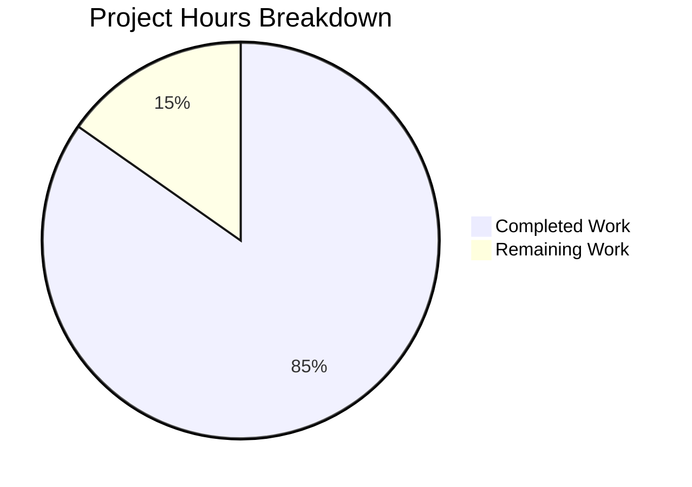

# 1. Executive Summary

## 1.1 Project Overview

A minimal, dependency-free Node.js HTTP server built as a teaching reference: one readable file, `server.js`, on `node:http` alone — no framework, middleware, router, dependency, build step or lockfile. It answers `GET /hello` with 200 and the body `Hello world`, every other method and path with 404 `Not Found`, logs one line per request, takes its port from `PORT` (default 3000, validated to 1024–65535) and shuts down cleanly on `SIGINT`. It is written for developers learning Node.js and for instructors showing what the runtime does without a framework. Three files and nothing else are delivered.

## 1.2 Completion Status

**85% complete — 50 of 59 hours**: 50 delivered and verified, 9 outstanding.



Completed = Dark Blue (#5B39F3); remaining = White (#FFFFFF).

| Metric | Hours |
|--------|-------|
| Total Hours | 59 |
| Completed Hours (AI + Manual) | 50 |
| Remaining Hours | 9 |

Calculation: 50 ÷ (50 + 9) = 84.7% → **85%**.

## 1.3 Key Accomplishments

- **`GET /hello`** — 200, `text/plain`, an 11-byte body, fixed-length framing.
- **Catch-all** — 404 `Not Found` (9 bytes) for every other method, path and target form.
- **Pathname matching** — query string discarded, trailing slash distinct, malformed target → ordinary 404.
- **Configuration** — `PORT` default 3000, digit-only 1024–65535, eleven rejected forms exiting 1 before any socket.
- **Lifecycle** — startup line after the bind; `EADDRINUSE` reported actionably with exit 1; `SIGINT` closes cleanly with exit 0.
- **Observability** — one three-field request line before routing, matched and unmatched alike.
- **Performance** — worst of ten samples 0.000349 s, 50/50 and 200/200 concurrency correct, memory flat over 5,000 requests.
- **Documentation** — a README whose every command runs as written and whose output matches the process.

## 1.4 Critical Unresolved Issues

**3 of 30 scoped items remain open** — the 29 requirements (F1–F10, N1–N7, I1–I12) plus the one acceptance criterion fixed but not executable on the build host. A fourth item, the wording of the `EADDRINUSE` remedy at port 65535, affects one message only and is listed in Section 2.2.

| Issue | Impact | Owner | ETA |
|-------|--------|-------|-----|
| The acceptance gates have not been run on the fixed Node.js 18.0.x floor; compatibility rests on API inspection | The claim that the server runs unmodified from 18.0.0 is unverified on that runtime, and the capability check's skip path is never taken where the API exists | Release engineer | 1 day |
| The generic fatal-error line `Fatal server error (<code>): <message>` (`server.js:141`) is built but has never been exercised | An unexpected server error would be reported by text nobody has seen produced; no HTTP response is involved either way | Maintainer | 0.5 day |
| `engines.node: ">=18.0.0"` admits end-of-life lines (18.x, 20.x) that receive no further security patches | A consumer can install an unpatched runtime; the range is unbounded above and npm treats the field as advisory | Project owner (decision) | 0.5 day |

## 1.5 Access Issues

| System/Resource | Type of Access | Issue Description | Resolution Status | Owner |
|-----------------|----------------|-------------------|-------------------|-------|
| Node.js 18.x runtime | Runtime installation | The fixed floor cannot be installed on the build host, so the acceptance gates cannot be executed on it | Open — needs a host or image that permits an 18.x runtime | Release engineer |

Nothing else is required.

## 1.6 Recommended Next Steps

1. **[High]** Run the documented checks, the rejections, the `EADDRINUSE` path and a `SIGINT` shutdown on Node.js 18.0.x.
2. **[High]** Drive the generic fatal-error line once and confirm its text and exit status.
3. **[Medium]** Settle the runtime floor: keep `>=18.0.0` and document the supported lines, or raise it and re-verify.
4. **[Low]** Decide the `EADDRINUSE` remedy's wording at port 65535, changing code and README together.

# 2. Project Hours Breakdown

## 2.1 Completed Work Detail

Every component traces to a requirement it satisfies and to the behaviour that was exercised against the running server.

| Component | Hours | Description |
|-----------|-------|-------------|
| `server.js` — configuration gate (`resolvePort`) | 2 | `PORT` defaulting to 3000, digit-only integer validation to 1024–65535, one actionable rejection line, exit status 1 before any socket exists (F2, F10, I4, I6). |
| `server.js` — request parsing, target-form guard, route table and dispatch | 3 | Pathname parsed from the request target with the query string discarded, base-relative and authority-carrying targets rejected, `ROUTES` keyed `METHOD pathname`, one handler or the catch-all (F1, F9, I1, I2, I3). |
| `server.js` — endpoint handlers and the single response writer | 2 | `GET /hello` → 200 and the catch-all → 404 written through one function using implicit headers, so `Content-Length` is 11/9 and no response is chunked (F3, F4, I7). |
| `server.js` — request-logging contract | 1 | One ISO-8601 timestamp, method and path line per request before routing, matched and unmatched alike (F5, I10). |
| `server.js` — lifecycle: startup, bind errors, `SIGINT` shutdown, exit statuses | 4 | Startup line from the `'listening'` event, the error listener registered before `listen`, a guarded `SIGINT` path with capability-checked idle-connection disposal, exit status 0 on success and 1 on a rejected configuration or failed bind (F6, F7, F8, I5, I6, I11, I12). |
| `server.js` — CONNECT catch-all and socket lifetime | 2 | The catch-all 404 written to the tunnelled socket as fixed bytes, the socket released as soon as the bytes are handed to the kernel, write errors on an abandoned connection absorbed (F4, I3). |
| `package.json` — manifest and entry point | 1 | The seven specified fields at their exact values, `main` and `scripts.start` resolving to `server.js`, no dependency object and no field beyond the seven (0.5.5, 0.4). |
| `README.md` — documentation | 5 | The eight required content items in order, thirteen runnable command blocks, both error-path texts, the shutdown sequence and the stalled-request recovery guidance (0.5.5, N6). |
| Verification — functional, configuration, console and lifecycle | 10 | The documented surface, the method and path space, eleven rejected `PORT` forms and the accepted range ends, the `EADDRINUSE` path, the shutdown sequence and the log format, exercised against the running server (0.8). |
| Verification — performance, concurrency, memory and connections | 6 | The latency gate and its series, concurrency runs from 50-way upward, the RSS series, connection reuse and descriptor stability (N1, N2, N3). |
| Verification — security boundaries, hygiene, access and adversarial input | 8 | The boundary demonstrations, header and body hygiene, access probes across the method space, traversal, injection, malformed and oversized targets, with log-integrity accounting (N4). |
| Verification — static gates, log integrity, documentation and manifest fidelity | 6 | Syntax and manifest checks, the placeholder sweep, claim-by-claim verification of the README against the process, and the manifest field set (N5). |
| **Total** | **50** | Matches the Completed Hours in Section 1.2. |

## 2.2 Remaining Work Detail

The outstanding work is verification and a decision, not code: the delivered behaviour is complete and every check exercised passes. Each category traces to a requirement or a recorded risk.

| Category | Hours | Priority |
|----------|-------|----------|
| Run the acceptance gates on the fixed Node.js 18.0.x floor, including the capability check's skip path (F7, I12, N7) | 4 | High |
| Exercise the generic non-`EADDRINUSE` fatal-error line and record its text and exit status (F8, error-handling specification) | 2 | High |
| Settle the runtime-floor policy for the end-of-life lines `engines.node` admits, and re-verify on whichever line is kept (runtime-floor constraint) | 2 | Medium |
| Decide the `EADDRINUSE` remedy's wording for a held port of exactly 65535, updating the code and the README transcript together if it changes (F8) | 1 | Low |
| **Total** | **9** | Matches the Remaining Hours in Section 1.2, and 50 + 9 = 59 total project hours. |

# 3. Test Results

Every check below was executed against the running server and its result observed; the table aggregates them by capability rather than listing them one by one. The harness is the tools this project permits — raw HTTP sockets, `curl`, and the runtime's own `http` client — on Node.js v22.23.3, since no test framework may be installed and no test file ships.

| Area / Category | Framework | Tests | Passed | Failed | Coverage | What This Proves |
|-----------------|-----------|-------|--------|--------|----------|------------------|
| Endpoint contract — status, header, body and framing | raw HTTP sockets, `curl`, built-in `http` client | 76 | 76 | 0 | Not measured — no coverage tool is permitted by the three-file deliverable set | `GET /hello` returns 200 `text/plain` with an 11-byte body and the catch-all returns 404 `text/plain` with a 9-byte body, fixed-length with no chunked framing (64-cell method × path matrix, 12 framing cases). |
| Request-target parsing and matching edges | raw HTTP sockets, `curl` | 56 | 56 | 0 | Not measured | Only the parsed pathname is matched: the query string is discarded, the trailing slash is a distinct path, and base-relative or authority-carrying targets cannot reach a handler (41 route-edge cases, 15 cases proving the request body, headers and cookies are never consulted). |
| Configuration gate — `PORT` | shell, running process | 18 | 18 | 0 | Not measured | The port is validated to a digit-only integer in 1024–65535 before any socket exists, rejected values print one actionable line and exit 1, and a privileged port is refused with no bind attempt (11 rejected forms, 4 accepted forms, the default, the privileged refusal, `EADDRINUSE`). |
| Console contract and log integrity | running process, log accounting | 80 | 80 | 0 | Not measured | One line per request in the fixed three-field format before routing, startup and shutdown lines once each and in order, and no value that can forge a second line (7+11+14+11+7+9+16+5 cases across the line families). |
| Lifecycle and shutdown | shell, raw sockets | 14 | 14 | 0 | Not measured | `SIGINT` logs both lines, closes cleanly and exits 0; a repeat signal is ignored; idle keep-alive sockets are disposed of; and a stalled request defers the completion line exactly as the README documents. |
| Concurrency, latency and memory | built-in `http` client, `curl`, `ps` | 10 latency samples, 4 load runs, 3 RSS samples | All within the specified bounds | 0 | Not measured | The request path is non-blocking and stateless: latency stays far below 10 ms, every concurrent request is answered correctly, and memory shows no upward trend. |
| Security, access and adversarial input | raw HTTP sockets, `curl` | 256 | 256 | 0 | Not measured | No injection class reaches a sink, no header or body hygiene leaks, no access control exists to bypass, and every hostile target still receives only the documented contract (98 access, 43 credential/header, 30 hygiene, 4 CORS, 24 boundary, 29 traversal/disclosure, 16 raw-byte and 12 framing-invariant cases). |
| Manifest and documentation fidelity | shell, `cmp`, running process | 85 | 85 | 0 | Not measured | The manifest carries exactly the seven specified fields at their values, and every documented claim, command and quoted console line matches what the process does (43 documented claims, 13 command blocks, 7 manifest fields, 22 forbidden-key probes). |

**Not Covered**

- **The fixed runtime floor.** No check has been executed on Node.js 18.0.0 or 18.1.0: the `typeof` capability check around idle-connection disposal (`server.js:170`) is never taken where the API exists, and the deferral those two patch levels produce is untested. Run the documented surface, the configuration rejections, the `EADDRINUSE` path and a `SIGINT` shutdown once on an 18.0.x runtime before release.
- **The generic fatal-error line.** `Fatal server error (<code>): <message>` (`server.js:141`) is implemented and reachable but has never been produced by a run. Drive it once and confirm its text, its stream and exit status 1.
- **Regression automation.** The repository ships no test file and no runner, by design — the deliverable set is three files and installing a framework is prohibited — so nothing re-runs these checks automatically. Before release, re-run the README's verification commands together with the configuration and shutdown checks by hand.
- **Runtime parser rejections.** `400`/`431` replies to request lines Node's parser refuses come from the runtime, not from this product, and are exercised only as a boundary: they produce no request log line and carry no product detail.

# 4. Runtime Validation & UI Verification

The server was started on private ports for each pass and stopped by the pid that started it; every port used was released afterwards. The flows a user or an operator touches were driven on the live process, and the endpoint contract was additionally driven from a real headless Chrome session (document navigation, in-page `fetch`, network capture of the response headers, console capture).

- ✅ **Start-up** — `node server.js` and `npm start` both bind and log `Server listening on port <resolved>`, npm's line being the fifth line of its banner-prefixed output; the default port 3000 is used when `PORT` is unset or empty.
- ✅ **Endpoint `GET /hello`** — 200, `Content-Type: text/plain`, `Content-Length: 11`, body `Hello world`, no `Transfer-Encoding`; confirmed by `curl`, by a raw socket and in the browser network capture, where the header set and the body byte count agreed.
- ✅ **Catch-all 404** — `Not Found` (9 bytes, `text/plain`) for `/invalid`, `/`, the trailing-slash form and every unmatched method; rendered in the browser as the server's own body with no interstitial.
- ✅ **Method enforcement** — `POST`, `PUT`, `PATCH`, `DELETE` and `OPTIONS` against `/hello` all return the identical 404, and `HEAD /hello` returns 404 with no body and no `Content-Length`.
- ✅ **Pathname matching edges** — `/hello?x=1` returns 200, `/hello/` returns 404, protocol-relative and backslash-authority targets return 404, the absolute form matches by pathname, and an unparseable target returns the ordinary 404 with no 500 or stack trace.
- ✅ **CONNECT** — answered with the byte-exact 136-byte catch-all 404, logged once, on every authority variant, with the socket released promptly and abandoned tunnels absorbed without an error line.
- ✅ **Configuration** — `PORT=8080` binds and serves on 8080 only; eleven malformed or out-of-range values each print the one documented line on stderr and exit 1 without a startup line; a privileged value is refused with no bind attempt; a second instance on a held port prints the actionable remedy and exits 1 while the first keeps serving.
- ✅ **Lifecycle and shutdown** — `SIGINT` prints `Received SIGINT, shutting down` then `Server closed` and exits with status 0 (also 0 under `npm start` when the server's own process is signalled), releases the port, ignores a repeat signal, and disposes of an idle keep-alive connection immediately.
- ✅ **Observability** — exactly one `[ISO-8601] [method] [path]` line per dispatched request in dispatch order, the query string excluded from the logged path, the raw target substituted for an unparseable one, never the literal `null`, and no error, stack or connection-reset line in any run.
- ✅ **Performance, concurrency and stability** — worst of ten latency samples 0.000349 s, 50 of 50 and 200 of 200 concurrent requests answered correctly, and RSS 56,780 → 61,660 kB across 5,000 requests with no upward trend.

**Never exercised at runtime.** The fixed Node.js 18.0.0/18.1.0 runtime itself — so the capability check's skip path and the idle-connection deferral on those two patch levels are unobserved — and the generic non-`EADDRINUSE` fatal-error line, which no run has produced. There is no user interface, screen, client bundle or rendered page in this product to verify visually, and no database, broker, cache, credential or external service exists to exercise: the server's only inbound integration is the HTTP client pointed at it, and its only outbound activity is the console lines it writes.

# 5. Compliance & Quality Review

## 5.1 Compliance Matrix

| Deliverable | Benchmark | Status | Evidence |
|-------------|-----------|--------|----------|
| Deliverable set | Exactly the specified files, no tooling, dependency, lock, container or CI artefact | ✅ Pass | `git ls-files` and a whole-tree listing both return `README.md`, `package.json`, `server.js`; no lockfile, `node_modules`, `.npmrc`, linter or editor config, `.gitignore`, Dockerfile, workflow, licence or test tree exists. |
| `GET /hello` contract | 200, `Content-Type: text/plain`, body `Hello world` | ✅ Pass | Observed 200 with `Content-Length: 11` and a byte-exact body under `curl`, a raw socket and a real browser navigation. |
| Catch-all contract | 404, `Content-Type: text/plain`, body `Not Found` for every other method and path | ✅ Pass | Observed for every unmatched method, path and target form, including CONNECT and `HEAD`, on a 64-cell method × path matrix with no mismatches. |
| Request-target matching | Match the parsed pathname; discard the query string; keep the trailing slash distinct | ✅ Pass | `/hello?x=1` → 200, `/hello/` → 404, base-relative and authority-carrying targets → 404, absolute form matched by pathname. |
| Request logging | One `[ISO-8601] [method] [path]` line per request before routing | ✅ Pass | One line per dispatched request in every run, matched and unmatched alike, with no forged, duplicate or error lines. |
| Configuration validation | `PORT` default, accepted range, actionable rejection before any socket | ✅ Pass | Default 3000 when unset or empty, overrides honoured, eleven rejected forms each one line with exit 1, privileged ports refused with no bind attempt. |
| Lifecycle and shutdown | Startup confirmation, `EADDRINUSE` handled actionably, clean `SIGINT` exit 0 | ✅ Pass | Startup line from the `'listening'` event, actionable bind-error message with exit 1 on a real held port, both shutdown lines with exit 0 and the port released. |
| Error handling | Actionable messages, no internal detail in any HTTP response | ⚠ Partial | The `EADDRINUSE` path and the malformed-target path are verified end to end; the generic non-`EADDRINUSE` fatal-error line is implemented but has never been produced by a run. |
| Runtime constraint | Run on the fixed floor and on current lines without edits | ⚠ Partial | Every API used is present at 18.0.0 and the single later API is reached behind a capability check; the server runs unmodified on this host's v22.23.3. No check has been executed on 18.0.x, whose line reached end of life. |
| Performance and concurrency | Under 10 ms on `/hello`; concurrent requests served without blocking | ✅ Pass | Worst of ten samples 0.000349 s; 50 of 50 and 200 of 200 concurrent requests answered correctly with one log line each. |
| Memory stability | No growth under repeated requests | ✅ Pass | RSS 56,780 → 61,660 kB across 5,000 requests, with no upward trend across samples and no per-request retention in the code. |
| Security boundaries | No dynamic evaluation, file-system access, outbound network, request-body/header/cookie processing or persistence | ✅ Pass | One `require` (`node:http`); no `eval`/`Function`, `fs`, `net`/`dns`/`fetch` or dynamic import anywhere; the request body, headers and cookies are never read; responses are two fixed bodies, so no hostile input reaches a sink. |

## 5.2 AAP & Rule Divergences and Gaps

No user-specified rules exist for this project — the rules document is empty — so no departure from a user rule is possible and none was found. The divergences below are departures from the AAP itself; each is reported even though the delivered behaviour is correct, because the plan specified something else.

| What the AAP Required | What Was Delivered Instead | Why It Diverged | Impact | Remediation |
|-----------------------|----------------------------|-----------------|--------|-------------|
| `getPathname` "returns the pathname of the request target via `new URL(req.url, 'http://localhost').pathname` … and returns `null` when the target cannot be parsed" | The same parse and the same `catch → null`, with a form guard ahead of them that returns `null` for a target carrying no path of its own (`server.js:25-42`) | The catch-all requirement and the README's "any other path → 404" rule outrank the implementation sentence: the prescribed parse alone resolves a target that names its own authority to the base host's pathname, so `//host/hello` would match the `/hello` route | The implementation sentence no longer describes the function exhaustively, and a guard-rejected target is logged in its raw form | None. If the sentence is later treated as exhaustive, the guard's comment states which behaviour it implements |
| `sendText` is "the single response writer, and the one place response framing is decided" | `sendText` remains the only `ServerResponse` writer; the CONNECT refusal is written to the tunnelled socket as fixed bytes in `handleConnect` (`server.js:98-125`) | Node hands CONNECT to the `'connect'` event with a bare socket, so there is no `ServerResponse` to pass to the writer, and the catch-all requirement covers every method including CONNECT | The catch-all status line and body exist at two write sites, so a future change must update both | None today. A review pass before any edit of `NOT_FOUND_BODY` or the CONNECT byte string |
| The `EADDRINUSE` sentence fixed as `... unused port: PORT=<port+1> node server.js` | Byte-identical for every held port from 1024 to 65534; at exactly 65535 the remedy reads `any unused port in the 1024-65535 range` (`server.js:135-137`) | `PORT=<port+1>` names 65536 at that one port, which the same program rejects, and the requirement is an *actionable* remedy | One message differs in one case; exit status, stream and every other fixed string are unchanged | Decide whether the sentence must be literal at 65535 and, if so, what it should say — 1 h, low priority |
| The shutdown behaviour table: the two lines, the graceful close, idle-connection disposal, exit 0 | Additionally documented: a connection whose request has begun defers `Server closed` and the exit past Node's default `headersTimeout` (60 s) and `requestTimeout` (300 s), a further CTRL+C is ignored, and the remedy is SIGKILL to the server's own process (`README.md:163, 171`) | The README must match what the process does, and the plan's table does not describe this case; no code, contract or configuration changed | None — documentation that makes the graceful close's real behaviour visible to an operator | None |
| "The checkout is empty", all three deliverables created | `README.md` published as an update of a two-line placeholder already tracked at that path; its contents wholly replaced | The premise did not hold on disk: the path carried a tracked scaffold file, and replacing its contents is what delivers the required documentation | The file's history begins at the placeholder, so a reader comparing commits sees a modification rather than an addition | None; the deliverable set is unchanged at three paths |
| The rejection message quoted with a literal `<raw>` token for the offending value | The README shows the message with the concrete value `abc`, byte-identical to what the process prints for it, and describes the interpolation in prose (`README.md:202`) | Shipping an angle-bracket token would itself be a placeholder, which the readiness requirement forbids in any shipped artefact | The transcript illustrates one value while the code's template is general | None; the prose states the rule the sample illustrates |
| Prerequisites content fixed as "Node.js 18.0.0 or newer, and how to check it", and nothing else | The shutdown section names `lsof` and `pgrep`, which the recovery commands need (`README.md:163, 168`) | The recovery commands must identify the server's own process rather than everything the port names; both utilities were already used by commands the README carries | A reader on a host without those utilities must use the PID they started the server with, which the same section states (`kill -INT "$!"`) | None, unless the prerequisites section is to enumerate host utilities — which would depart from its fixed content |

**The form guard.** The plan fixes the parse and permits exactly one `null` outcome: a target that cannot be parsed. `new URL(target, 'http://localhost')` is a reference resolution, so a target naming its own authority comes back with that authority's pathname rather than this server's — `//host/hello` and `/\host/hello` both resolve to `/hello` and would match the single route, although any path other than `/hello` must return 404. The delivered function keeps the prescribed expression and its catch verbatim and adds a guard (`server.js:25-42`) admitting only origin-form and absolute-form targets. The plan's implementation sentence is therefore no longer exhaustive, and a rejected target's raw form is what the request log carries in its third field. No decision is outstanding.

**The second 404 writer.** `sendText` is specified as the single response writer and the only place response framing is decided. Node never delivers CONNECT to the request listener: it emits `'connect'` with the tunnelled socket, so there is no `ServerResponse` to hand to `sendText`, and without a `'connect'` listener the connection is destroyed and the method gets no response at all. The refusal is therefore written in `handleConnect` (`server.js:98-125`) as fixed bytes, with the body single-sourced through `NOT_FOUND_BODY` and its length derived, so the two write sites cannot advertise different bodies. If the catch-all status or body ever changes, update both places together — the two sites are the only coupling this divergence creates.

**The 65535 remedy.** The plan fixes the `EADDRINUSE` sentence with `PORT=<port+1>`, and the program's accepted range is 1024–65535. At a held port of exactly 65535 that template names 65536, which `resolvePort` rejects with exit status 1 — an actionable message naming an unusable action. The delivered line keeps the plan's sentence byte-identically for every port from 1024 to 65534 and, at 65535 alone, advises "any unused port in the 1024-65535 range"; the README carries both forms (`README.md:215, 224`). Exit status and all other fixed strings are unchanged. Decide whether the literal sentence is required at that port; if it is, choose the wording and change the code and the transcript together.

**The stalled shutdown.** The plan's shutdown table stops at the graceful close, in-flight requests and idle-connection disposal. A connection whose request has begun and not finished is not idle, so `close()` waits for it and the completion line and exit follow only when that client goes away — past Node's default `headersTimeout` (60 s) and `requestTimeout` (300 s) — while a second CTRL+C is ignored. The README documents that wait and names the recovery (`README.md:163, 171`): `kill -KILL "$(pgrep -f 'node server.js')"`, or `$!` when the server is the shell's own background job, because the listening socket no longer identifies the process once the shutdown has closed it. Documentation only — no code, contract or configuration changed.

**The README as an update.** The plan records an empty checkout and all three deliverables as creations. The repository already tracked a two-line placeholder at `README.md`, so the file was published as an update with its contents replaced in full — no scaffold heading, no generator line and no second documentation file. The shipped file is complete and the deliverable set is unchanged at three paths; the only consequence is that the file's history begins at the placeholder, so a reader comparing commits sees a modification rather than an addition. Nothing to close.

**The `<raw>` sample.** The plan quotes the rejection message with a literal `<raw>` token where the offending value is interpolated. Shipping that token would put an angle-bracket placeholder into a documentation sample, which the readiness requirement forbids in any shipped artefact. The README therefore shows the message with the concrete rejected value `abc` — byte-identical to what the process prints for that value (`README.md:202`) — and states in prose that the value is interpolated as supplied, with control characters rendered escaped. What a reader must know: the transcript illustrates one value while the template in the code is general.

**`lsof` and `pgrep`.** The plan fixes the prerequisites content as the Node.js version requirement and how to check it, and nothing else. The shutdown section names `lsof` and `pgrep`, because the recovery commands must identify the server's own process rather than "everything the port names" — the plan's own concern in that section. Both utilities were already used by commands the README carries, and `lsof` is installed on the documented environments. A reader without them can still act: the same section gives `kill -INT "$!"` and `kill -KILL "$!"` for a server started as the shell's background job. Nothing to close unless the prerequisites section is to enumerate host utilities, which would depart from its fixed content.

# 6. Risk Assessment

Risks are forward-looking: what could still go wrong once this code is in use. Each carries the mitigation already in place and what remains to be done.

| Risk | Category | Severity | Probability | Mitigation | Status |
|------|----------|----------|-------------|------------|--------|
| `engines.node: ">=18.0.0"` admits end-of-life runtime lines (18.x ended 2025-04-30, 20.x ends 2026-04-30) that receive no further security patches, and npm treats the field as advisory | Security | High | High, if a consumer installs an EOL line | Decide the floor: keep the value — it is unbounded above, so 22.x/24.x/26.x satisfy it — and state the supported lines in the README, or raise it and re-run the gates on that line | Open — accepted and recorded, awaiting a decision |
| A client that begins a request and never finishes it is not idle, so `close()` waits for it and the process stays alive past Node's default `headersTimeout` (60 s) and `requestTimeout` (300 s) | Technical | Medium | Medium | The README documents the wait and the recovery — SIGKILL to the server's own process, selected by command line or `$!`; a code-side bound would require a timeout input the deliverable set excludes | Open — documented and accepted |
| No test file or runner ships, so regression detection depends on re-running the documented checks by hand | Technical | Medium | Medium | The README's verification section is the procedure and every command in it is runnable as written; keep the equivalent gate script outside the repository and run it before each release | Open by design |
| The service is plaintext and unauthenticated and binds the unspecified address, so it is reachable from the machine's own network interfaces | Security | Low | Medium | Run it only on a trusted host or a loopback-only environment; TLS, a `HOST` input and access control are outside the scoped deliverable | Accepted by design |
| There is one process and no clustering, so any future blocking or `*Sync` work added to the request path would stall every concurrent request | Technical | Medium | Low | Keep the request listener synchronous and I/O-free, as it is today, and add I/O only through asynchronous calls | Watch |
| Port 3000 is the documented default and may already be in use on a developer's machine | Operational | Low | High | The bind failure is caught: the message names the failed port and the next one, and the advised port starts and serves; start with an explicit `PORT` where 3000 is taken | Accepted, verified against a held port |
| Observability is console-only — no log file, metrics, health endpoint or tracing — so a detached run nobody watches leaves no record | Operational | Low | Medium | Redirect stdout and stderr to a file when starting detached, as the commands in this guide do | Accepted by design |
| Node's own parser answers `400`/`431` to request lines it refuses, with no request log line and a runtime-generated body outside the documented contract | Integration | Low | Low | None required: every listener-reached target receives the documented 404, and the parser's reply carries no product detail | Accepted, verified |

No integration risk arises from external systems: this product has no dependency, credential, database, queue, webhook or outbound call to configure, break or leave unset.

# 7. Visual Project Status


**Completed work is Dark Blue (#5B39F3); remaining work is White (#FFFFFF).** Overall completion is **85%** — 50 of 59 hours.

Remaining hours by category, from Section 2.2:

| Category | Hours | Priority |
|----------|-------|----------|
| Acceptance run on the fixed Node.js 18.0.x floor, including the capability check's skip path | 4 | High |
| Exercise the generic non-`EADDRINUSE` fatal-error line | 2 | High |
| Runtime-floor policy for the end-of-life lines the `engines` range admits, with re-verification | 2 | Medium |
| `EADDRINUSE` remedy wording at a held port of exactly 65535 | 1 | Low |
| **Total** | **9** | |

Integrity check: the chart's "Remaining Work" value is the same 9 hours as the Remaining Hours row in Section 1.2 and the total of the table above; "Completed Work" is the 50-hour total of Section 2.1; 50 + 9 = 59 total project hours, giving 85% complete.

# 8. Summary & Recommendations

The project delivers a complete, dependency-free Node.js HTTP server in three files: `server.js` (the whole application), `package.json` (the manifest and the `npm start` entry point) and `README.md` (a guide a first-time user can follow end to end). It answers `GET /hello` with 200, `Content-Type: text/plain` and the 11-byte body `Hello world`; every other method, path and request-target form with 404 and the 9-byte body `Not Found` — including CONNECT, `HEAD` and targets that name another host; it logs exactly one `[ISO-8601] [method] [path]` line per request before routing; it validates its port to a digit-only integer in 1024–65535 before any socket exists, defaulting to 3000; it reports a bind failure with an actionable remedy and exits 1; and it shuts down on `SIGINT` with two console lines, a clean close and exit status 0, ignoring a repeat signal. Nothing outside those three files exists in the tree — no dependency, lockfile, build step, container, pipeline or tooling.

Everything above was exercised against the running process and observed: the endpoint contract by `curl`, by raw HTTP sockets and from a real browser session; the method and path space across a 64-cell matrix with no mismatch; eleven rejected `PORT` forms and the accepted range ends; the `EADDRINUSE` path against a genuinely held port; the shutdown sequence including a repeat signal, an idle keep-alive connection and a stalled request; the request log's format, ordering and integrity; latency, concurrency and memory; and the security boundaries, hygiene and adversarial input sweeps. The README's own commands were executed as written and its quoted output matches the process, so a reader can reproduce the same observations without reading the source.

The project stands at **85% complete — 50 of 59 hours** — and the outstanding 9 hours are verification and one decision rather than unfinished functionality: running the acceptance gates on the fixed Node.js 18.0.x runtime and recording the result (4 h), driving the generic fatal-error line once (2 h), settling the runtime-floor policy for the end-of-life lines `engines.node` admits (2 h) and deciding the `EADDRINUSE` remedy's wording for a held port of exactly 65535 (1 h). The critical path is the runtime-floor item: it is the only piece of work that can change a claim the documentation makes, and it is also the cheapest to close if the project simply states which lines it supports.

Production readiness: the deliverable is ready to run and to be read. Its behaviour is fully specified, completely implemented and observed under every input the specification names, and its operational edges are documented in the same file a user already reads. The two caveats a sign-off should carry are that the fixed runtime floor has not been exercised on 18.0.x and that the floor admits runtime lines that no longer receive security patches — both recorded above with their owners. Success for this project is therefore measurable and already met: the documented commands produce the documented output, no request reaches a handler it should not, no input produces anything other than the two fixed bodies, and the process starts and stops cleanly every time.

# 9. Development Guide

Every command below was executed from the repository root and its output observed; the ports shown were used for verification and any free port can be substituted.

## 9.1 Prerequisites

- **Node.js 18.0.0 or newer** — and nothing else. Check it:
  ```bash
  node --version
  ```
  Observed on the host this guide was verified on: `v22.23.3`, with `npm` `11.21.0`.
- `package.json` declares the requirement as `"engines": { "node": ">=18.0.0" }`. npm treats `engines` as advisory: it warns when the installed runtime does not satisfy the range and refuses to run only when the `engine-strict` configuration option is enabled.
- No database, message broker, cache, container runtime or credential is needed, and no network access beyond the machine itself.

## 9.2 Environment Setup and Installation

None is required. There is no dependency to install, no lockfile, no `node_modules`, no `.npmrc` and no build step, so `npm install` has nothing to fetch and must not be run to "set up" the project. From a fresh checkout the equivalents of the build gate are:

```bash
node --check server.js
node -e "require('./package.json')"
```

Both print nothing and exit 0. There is no environment variable to set other than `PORT`, and there is no configuration file.

## 9.3 Running the Server

From the repository root, with either entry point:

```bash
node server.js
```

```bash
npm start
```

Once the port is bound the server logs one line. `npm start` prints npm's four-line banner first, so the server's line is the fifth line of the output:

```console
$ node server.js
Server listening on port 3000
```

```console
$ npm start

> nodejs-tutorial-hello-world@1.0.0 start
> node server.js

Server listening on port 3000
```

The server binds the unspecified address, so it answers on `localhost`, on `127.0.0.1` and on the machine's own address. To run it on another port, set `PORT`:

```bash
PORT=8080 node server.js
```

To run it detached, keep its output in a file you can read later, and remember the pid so you can stop it:

```bash
PORT=8080 node server.js > server.log 2>&1 &
echo $!
```

If you start it detached with `npm start` instead, `$!` is npm's pid rather than the server's; stop it by the owner of the listening port, as shown in 9.6.

## 9.4 Verifying the Server

With the server running on the default port (substitute your own port if you set `PORT`):

```bash
curl -i http://localhost:3000/hello
```

```console
HTTP/1.1 200 OK
Content-Type: text/plain
Date: Mon, 19 Oct 2026 11:26:53 GMT
Connection: keep-alive
Keep-Alive: timeout=5
Content-Length: 11

Hello world
```

```bash
curl -i http://localhost:3000/invalid
```

```console
HTTP/1.1 404 Not Found
Content-Type: text/plain
Date: Mon, 19 Oct 2026 11:26:53 GMT
Connection: keep-alive
Keep-Alive: timeout=5
Content-Length: 9

Not Found
```

The remaining cases:

```bash
curl -i -X POST http://localhost:3000/hello    # 404 — the method is part of the route key
curl -i 'http://localhost:3000/hello?x=1'      # 200 — the query string is discarded before matching
curl -i http://localhost:3000/hello/           # 404 — the trailing slash is a different pathname
curl -i http://localhost:3000/                  # 404
```

Each request adds exactly one line to the server's output, in the three-field format:

```console
2026-10-19T11:26:53.412Z GET /hello
2026-10-19T11:26:53.498Z GET /invalid
```

No response carries a `Transfer-Encoding` header, and `Content-Length` always equals the body's byte count (11 or 9).

## 9.5 Configuration

One environment variable configures the server:

| Variable | Default | Accepted values |
|----------|---------|-----------------|
| `PORT` | `3000`, when the variable is unset or empty | An integer between `1024` and `65535` |

The value must be a base-10 integer written in digits, with no sign, whitespace, decimal point, exponent or trailing characters. A value that fails either test is rejected before any socket is created:

```bash
PORT=abc node server.js; echo $?
```

```console
Invalid PORT value "abc": PORT must be an integer between 1024 and 65535. Example: PORT=8080 node server.js
1
```

`80`, `0`, `65536`, `80.5`, `3000.5`, `-3000`, `' 3000'`, `0x1F90`, `3e3`, `3000abc` and `+3000` are rejected the same way, each with one line on stderr, exit status 1 and no startup line. Ports `1`–`1023` are privileged, which is why the accepted range starts at `1024`: a privileged port is refused rather than bound, and no bind is ever attempted for one.

## 9.6 Shutting Down

Press CTRL+C in the terminal running the server:

```console
^CReceived SIGINT, shutting down
Server closed
```

The shutdown stops accepting new connections and lets requests already in flight finish, after which the process exits with status 0. A second CTRL+C during the shutdown is ignored. Only `SIGINT` is handled: `SIGTERM` ends the process without those two lines.

To signal it from another shell or a script, select the listening socket so nothing else on the port is signalled:

```bash
kill -INT "$(lsof -ti :3000 -sTCP:LISTEN)"
```

If the server is a background job of your shell (`node server.js &`), its pid is `$!`:

```bash
kill -INT "$!"
```

Under `npm start &` the background job is npm rather than the server and npm does not forward the signal, so use the `lsof` form above, which reaches the server under either entry point.

## 9.7 Troubleshooting

**`Invalid PORT value ...` and exit status 1** — the value is not a digit-only integer in 1024–65535 (for example `80`, `0`, `65536`, `3000.5`, `0x1F90`). Start with a value inside the range: `PORT=8080 node server.js`.

**`Port 3000 is already in use. Stop the process using it, or start the server on an unused port: PORT=3001 node server.js`** — another process holds the port, and exit status is 1 rather than a crash. Use the port the message names, or choose your own. At a held port of exactly 65535 the message advises `any unused port in the 1024-65535 range` instead, because there is no next port to name.

**`Received SIGINT, shutting down` with no `Server closed`** — a client has an unfinished request in flight and the graceful close is waiting for it; Node's default `headersTimeout` (60 s) and `requestTimeout` (300 s) do not end that wait, and a further CTRL+C is ignored. End it by signalling the server's own process:

```bash
kill -KILL "$(pgrep -f 'node server.js')"
```

or `kill -KILL "$!"` when the server is the shell's background job. The listening socket no longer identifies the process at that point, because the shutdown has already closed it, and an unfiltered `lsof -i :3000` would select every process connected to the port.

**Nothing answers on the port you expected** — check the startup line names the port you asked for, then confirm the port is held by this process: `lsof -ti :3000 -sTCP:LISTEN`. If the port is free and no startup line appeared, the configuration was rejected or the bind failed, and the reason is on stderr.

**An idle keep-alive client seems to delay the exit** — on Node.js 18.2.0 and later the server disposes of idle connections as part of the shutdown. On 18.0.0 and 18.1.0 that API does not exist, so the server skips it and an idle connection can defer the exit by up to `keepAliveTimeout` (5000 ms), after which Node destroys the socket.

**Cleaning up a detached run** — stop it by the pid that started it, or by the owner of its port: `kill -INT "$(lsof -ti :<port> -sTCP:LISTEN)"`. Nothing is left behind: the product writes no file, holds no state and needs no teardown.

# 10. Appendices

## A. Command Reference

Run every command from the repository root.

| Purpose | Command |
|---------|---------|
| Check the runtime version | `node --version` |
| Check the npm version | `npm --version` |
| Syntax-check the application | `node --check server.js` |
| Parse-check the manifest | `node -e "require('./package.json')"` |
| Print the manifest's fields | `node -e "const p=require('./package.json');console.log(p.name,p.version,p.main,p.scripts.start,p.engines.node,p.keywords.join(','))"` |
| Start the server | `node server.js` |
| Start the server through npm | `npm start` |
| Start on a chosen port | `PORT=8080 node server.js` |
| Start detached, output captured | `PORT=8080 node server.js > server.log 2>&1 & echo $!` |
| Fetch the endpoint | `curl -i http://localhost:3000/hello` |
| Fetch an unmatched path | `curl -i http://localhost:3000/invalid` |
| Show method matching | `curl -i -X POST http://localhost:3000/hello` |
| Show query-string handling | `curl -i 'http://localhost:3000/hello?x=1'` |
| Show trailing-slash handling | `curl -i http://localhost:3000/hello/` |
| Measure latency | `curl -s -o /dev/null -w '%{time_total}\n' http://localhost:3000/hello` |
| Count request log lines | `grep -cE '^[0-9]{4}-[0-9]{2}-[0-9]{2}T[0-9]{2}:[0-9]{2}:[0-9]{2}\.[0-9]{3}Z (GET\|POST\|PUT\|PATCH\|DELETE\|OPTIONS\|HEAD) ' server.log` |
| Reject an invalid port | `PORT=abc node server.js; echo $?` |
| Shut down cleanly | `kill -INT "$(lsof -ti :3000 -sTCP:LISTEN)"` |
| Confirm a port is held | `lsof -ti :3000 -sTCP:LISTEN` |

## B. Port Reference

| Port | Role |
|------|------|
| `3000` | The documented default, used when `PORT` is unset or empty |
| `1024`–`65535` | The accepted range; both ends inclusive |
| `1`–`1023` | Privileged on Unix-like systems and refused before any bind attempt |
| `65535` | The highest accepted port; when it is the port already held, the bind error advises any unused port in the accepted range rather than a next port |
| Any free port | Used for verification in this guide (3000, 8080, 33911, 33912, 31999) and released afterwards |

## C. Key File Locations

| Path | Contents |
|------|----------|
| `server.js` | The entire application: port validation, HTTP server creation and binding, the bind-error handler, request logging, the route table, the `/hello` handler, the catch-all 404 handler, the CONNECT catch-all, the shared response writer and the `SIGINT` shutdown path |
| `package.json` | The seven manifest fields: `name`, `version`, `description`, `main`, `scripts.start`, `engines.node`, `keywords` |
| `README.md` | Purpose, prerequisites, installation, running, verifying, expected output, shutting down and configuration |

The repository contains exactly these three files and no other tracked path.

## D. Technology Versions

| Component | Version | Note |
|-----------|---------|------|
| Node.js (host verified on) | `v22.23.3` | Satisfies the declared floor |
| npm | `11.21.0` | Only used to run the `start` script |
| `engines.node` | `>=18.0.0` | The declared floor; unbounded above, so the supported 22.x, 24.x and 26.x lines satisfy it. 18.x reached end-of-life on 2025-04-30 and 20.x on 2026-04-30 |
| Built-in modules | `node:http` only | `process`, `console`, `URL` and `Date` are globals and need no import |
| Third-party dependencies | none | No lockfile, no `node_modules`, no install step, no build step |
| Post-18.0.0 API used | `server.closeIdleConnections()` (18.2.0) | Called only behind a `typeof` capability check |

## E. Environment Variable Reference

| Variable | Required | Default | Accepted values | On rejection |
|----------|----------|---------|-----------------|--------------|
| `PORT` | No | `3000` when unset or empty | A digit-only base-10 integer from `1024` to `65535` | One line on stderr, exit status 1, no socket created and no startup line |

No other environment variable, secret, configuration file or credential is read by this project, and `process.env.PORT` is the only environment access in the program.

## F. Developer Tools Guide

| Tool | What it gives you here |
|------|------------------------|
| `node` | Runs the server, syntax-checks the source (`node --check`) and evaluates the manifest (`node -e`) — the project's whole build gate |
| `npm` | Runs `scripts.start`; it is not needed for anything else, and `npm install` has nothing to do |
| `curl` | Issues the documented requests and shows the status line, headers and body; `-w '%{time_total}'` times a request |
| `lsof` | Identifies the process that owns a listening port (`lsof -ti :3000 -sTCP:LISTEN`), which is how the documented shutdown command selects the server |
| `pgrep` | Selects the server by its command line (`pgrep -f 'node server.js'`) when the listening socket no longer identifies it |
| `grep` | Counts and inspects the request log lines by format |
| `ps` | Samples resident memory (`ps -o rss= -p <pid>`) to confirm the process retains nothing per request |
| `git` | Shows the three tracked files and their history; the repository's hooks are Git LFS hooks and run as normal |

## G. Glossary

| Term | Meaning here |
|------|--------------|
| catch-all | The route that answers every method and path the route table does not match, with 404 and the body `Not Found` |
| origin-form target | A request target that is a path on this server, such as `/hello` |
| authority-form target | A request target naming a host and port, used by CONNECT, such as `localhost:3000` |
| absolute-form target | A request target carrying a scheme and host, such as `http://example.com/hello`, matched on its pathname |
| implicit header mode | Writing a response by assigning `res.statusCode` and calling `res.setHeader` before `res.end(body)`, which lets Node generate `Content-Length` and produce fixed-length framing |
| `EADDRINUSE` | The error the operating system reports when another process already holds the port being bound |
| idle connection | A keep-alive socket with no request in progress; it is disposed of during shutdown where the runtime provides the API for it |
| in-flight request | A request that has begun and not finished; the graceful close waits for it, which is why an unfinished one can defer the exit |
| capability check | The `typeof` test that calls `closeIdleConnections()` only where the runtime provides it, keeping the code valid from Node.js 18.0.0 |
| completion percentage | Completed hours divided by total scoped hours — 50 of 59, giving 85%
